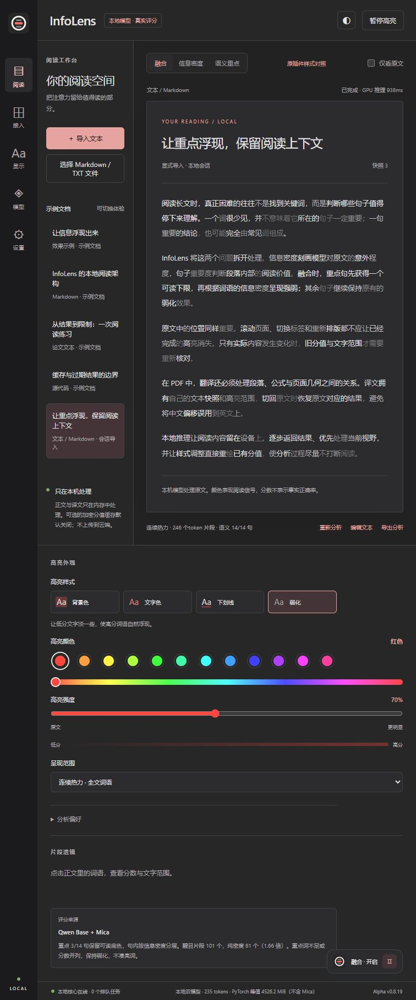
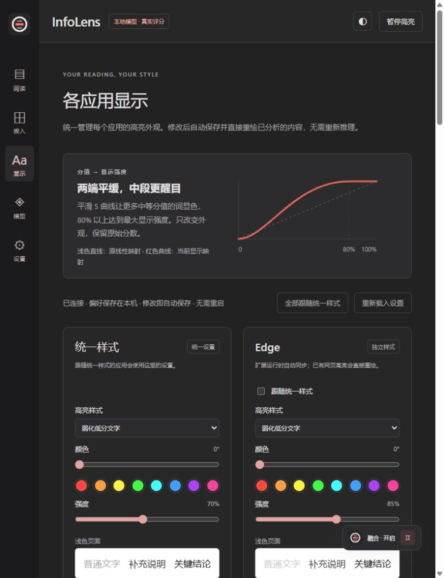
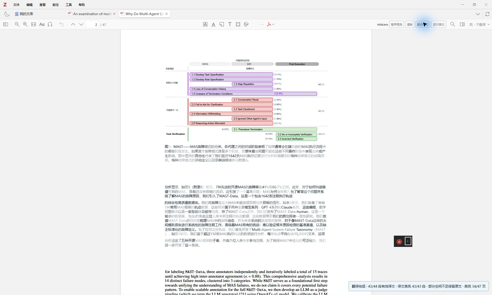

# 本地智能阅读助手 InfoHighlight

阅读助手以保留句意、突出重点为设计目标，帮助读者更有效地筛选长文信息。项目基于 dqy08 的开源 InfoLens 高亮方案，适配网页、技术文档和论文。开发从具体阅读需求出发，将使用要求拆解为开发任务，借助开发 Agent 实现功能，再通过实际阅读检查显示和操作。阅读中出现的辨认困难、结果消失和翻译错位，成为后续调整规则的依据。

## 句词融合机制

信息密度能够突出较难预测的词语，但单独使用时容易削弱重点句的完整性。原有高亮根据模型对原文的预测概率形成明暗差异，而重要结论也可能主要由常见词组成。这类句子被弱化后，只剩几个醒目片段，读者需要重新辨认连接关系。由此可见，词语的显示强度还需要考虑整句在段落中的作用。

句子重要度提供了保留完整论述的依据，词级信息密度则继续区分局部重点。模型先读取自然段，再对段内句子评分，使重要度判断包含上下文。显示时，句子评分决定哪些句子需要保持可读，词级分数决定其中哪些词语更醒目。两类判断分别作用于句子和词语，使重点句能够保留句意，也保留内部层次。

## 重点句显示规则

重点句的可读下限用于补足过淡的词语，整句提亮的范围则需要受到约束。融合模式只提高选中句子的最低可见程度，其余内容沿用信息密度效果；句子分数接近时保持中性，醒目片段的数量也受到重点句范围限制。这样，重点句中的常见词可以被读到，同时减少整段一起变亮、句内重点消失的问题。

## 中文整词显示

中文高亮需要以完整词语作为显示单位，模型的切分结果并不总能满足这一要求。逐片段着色曾使“递归”只显出“递”，读者看到的是单字，而非完整概念。显示层因此按整词聚合，并核对词语对应的字符范围。评分仍来自模型分析，但视觉呈现围绕可直接辨认的词语组织，减少词内被拆淡造成的理解负担。

# 跨应用阅读适配

## 共享显示设置

跨应用使用需要共享显示偏好，同时适应各自的阅读环境。网页、编辑器和论文阅读器如果独立配置，调整一种样式就需要重复操作；但不同背景和排版也会改变同一强度的可读性。工作台因此集中管理背景色、文字色、下划线和弱化，各端既可继承，也可单独设置，使统一操作保留必要的局部调整空间。

显示强度应当能够独立调整，使阅读偏好不必通过重新分析原文来实现。针对“低分仍不够淡”“中等分值很少醒目”等反馈，项目调整分数到显示强度的转换曲线，保留原始评分；颜色或强度改变后，直接重绘已有结果。用户由此可以即时比较样式差异，各端适配器则负责把新的显示规则放回原有文本结构。

## 分析结果复用

滚动或缩放改变的是文字的显示位置，已有分析应当继续保留。早期页面重建文字层后，高亮可能消失，但此时原文内容没有改变，重新推理只会让用户重复等待。结果因此先按文本保存，页面重建时重新寻找有效范围，再把原有分数画回相应位置。这一处理将页面重绘和内容分析分开，延续已经完成的阅读结果。

## 分析结果的归属校验

文档切换后，后台结果需要重新核对所属内容，才能避免把旧分析显示到新页面。任务完成时，用户可能已经打开另一份文档，因此结果同时记录文档、内容和字符范围，并在写回前检查。原文编辑或任务取消后，失效结果停止显示；仍符合当前内容的结果继续复用。任务完成后仍需确认文本匹配，才能将分析恢复到对应页面。

长文分析采用逐步显示，使后台计算期间已经完成的部分可以继续阅读。Zotero 持续分析全文，优先处理当前阅读区域，完成一段便补充一段；页面同时区分处理中、已完成、取消和失效的任务。局部任务变化时，只更新相应内容，减少整页清空重画。读者因此可以先查看已完成分析的段落，未完成的部分由后台继续补充。

# 论文原位翻译

## 论文翻译处理规则

论文原位翻译首先要保留正文、公式和图表的联系，输入整理因此先于文本翻译。早期直接处理 PDF 提取文本时，变量、上下标和错误字符映射混入正文，出现公式乱码、残留英文和断句。项目据此将可翻译正文和需要保护的数学内容分开，让后续模型处理明确的语言段落，减少混合输入对论文含义的破坏。

数学内容采用保留原有表现的处理方式，使翻译主要作用于正文。正文按段落组织，行内公式保留顺序和位置，独立公式继续显示原页面；无法可靠还原的符号字体保留原字形。这些规则使变量和公式仍能在原来的位置被辨认，读者阅读译文时也可以结合相邻数学内容理解论述。

译文的呈现需要服从页面空间，并保留返回原文的路径。翻译优先处理当前阅读区域，完成一段便排入原文所在位置；空间不足或段落无法可靠定位时，继续显示原文，用户也可以主动切回。原位显示由此按段落逐步完成，已经能够阅读的内容先出现，难以排入的部分仍保留原页面的阅读入口。

## 译文高亮映射

原文和译文需要分别保存高亮结果，因为翻译会改变文字长度和排列。早期切换时，原文和译文的字符位置混用，造成高亮错位。后续为两者分别保留文本和评分，显示时使用对应范围，切回原文便恢复原文映射。翻译和高亮分别维护临时显示层，使两项功能能够同时使用，也保留源 PDF 和正式批注。

## 本地多模型部署

本地多模型部署源于三类任务对模型输出的不同要求。信息密度分析需要计算原文中每个词的预测概率，句子评分需要判断一句话在段落中的作用，翻译则需要生成完整译文。若将这些任务都交给同一种生成式接口，词级概率和句子评分还需额外转换，处理长文时也会增加等待。因此，项目按任务选择模型，让每类结果直接进入对应的阅读功能。

信息密度分析部署 Qwen2.5-1.5B Base，采用 BF16 精度读取原文的词元概率；句子重要度评分部署 Mica 4B，采用 Q5_K_M 量化，在段落上下文中对句子评分，并直接读取评分选项的概率，减少长文本生成及结果解析；原位翻译部署 HY-MT1.5-1.8B，采用 NF4 量化生成译文。前两者共同决定高亮层次，翻译模型处理整理后的正文，形成各自明确的输入和输出。

模型分工还需要配套资源调度，才能在多个阅读应用中持续使用。三种模型由 Windows 推理服务预先加载，在 RTX 4070 Super 的 12GB 显存下，通过共享队列串行处理请求。浏览器、编辑器和 Zotero 共用已经加载的模型，减少重复占用及并发争抢；分析先返回信息密度，再补充句子评分，使已完成的结果及时显示。模型选择由任务需要决定，共享服务则将这些能力接入连续阅读。

验证重点落在连续阅读中的具体操作，使功能判断能够对应实际使用。项目检查了点击反馈、结果逐步出现、滚动保留、标签切换和译文显示，并完成真实 GPU 推理及 Zotero 页面重绘检查。出现过的错位、失效回填和公式损坏被记录为回归场景，保留对应操作及预期显示，为后续修改提供可重复检查的条件。

[InfoHighlight 项目](https://github.com/LinXin-CMU/InfoHighlight) · [上游 InfoLens 项目](https://github.com/dqy08/InfoLens) · [截图中的论文](https://arxiv.org/abs/2503.13657)
